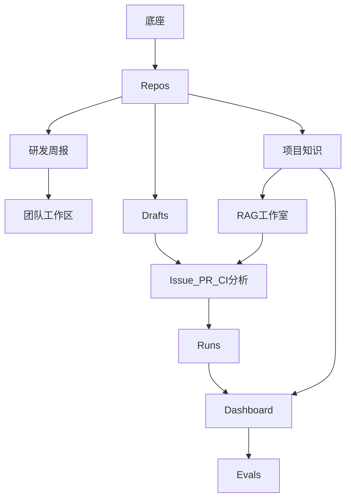

# 菜单实施顺序

不先做 Dashboard。它是聚合页，把仓库、分析、记忆和对话摊在同一屏里，一开始做等于把后面九个菜单的后端提前做完。顶栏顺序只是导航，不是实施顺序。

算法细节仍以 [全量重写方案](.cursor/plans/devflow_全量重写方案_634f3f36.plan.md) 第 2 节为准。每一步动手前回读对应源码。不创建 `docker-compose.yml`，Postgres 用本机已有实例，`DATABASE_URL` 放在 `backend/.env`。

## 哪些菜单互相独立

真正独立的只有「已经有仓库数据之后」的三条线，它们彼此不调用：

- 研发周报只读已同步的 Issue、PR、CI；团队工作区复用这份周报
- Drafts 只用仓库 token 去执行写操作
- Code Graph 延后。它只读检出的代码和 PR 列表，当前菜单不依赖它

项目知识和 RAG 工作室共用同一套检索，必须紧挨着做。Runs 要调用分析 Agent 和检索。Dashboard 要调用前面几乎全部能力，再加会话、记忆和对话。Evals 要在隔离事务里跑生产对话，只能放最后。

源项目还有 `/issues`、`/pull-requests`、`/ci` 三个页面，本项目顶栏没有这三项。它们的分析服务仍然要在 Runs 之前做完，因为工作流任务和以后的 Dashboard 右栏都调用它们。本顺序不为这三个地址单独做页面。

## 实施步骤

约定：后端 `cd backend && pnpm start:dev`（8000），前端 `cd frontend && pnpm dev`。纯算法用 jest。验证不过不进入下一步。Entity 随当前菜单需要的表增加，`synchronize: true`，不一次性建完全部表。

### 0. 底座

改 [backend/src/main.ts](backend/src/main.ts)、[backend/.env.example](backend/.env.example)、`backend/src/common`、`backend/src/modules/llm`、[frontend/lib/api.ts](frontend/lib/api.ts)。连接已有 Postgres，启动时 `CREATE EXTENSION IF NOT EXISTS vector`；按 `NODE_ENV` 加载 `.env`、`.env.test` 或 `.env.production`；CORS；`GET /health`；当前用户、权限、审计、AES-256-GCM、`LlmService`、`estimateTokens`。这一步只建 `users`。

验证：`curl localhost:8000/health` 返回 `{"status":"ok"}`；库里能查到 `vector` 扩展；去掉必填变量时启动失败并指出变量名；jest 覆盖加解密往返和 token 估算。

### 1. Repos

这是后面所有菜单的数据入口。做 GitHub 同步、`POST /api/repos/connect`、列表、select、sync、delete，以及 [frontend/app/repos/page.tsx](frontend/app/repos/page.tsx)。表：`repositories`、`issues`、`pull_requests`、`pr_files`、`pr_review_comments`、`audit_logs`。Actions 运行记录延后。

验证：页面连接一个远程仓库后能看到同步结果；「设为当前查看」后排序变化；刷新和删除可用。jest 覆盖分页、limit 截断和子请求失败降为 partial。

### 2. Code Graph

延后，见文末待办。页面保持占位。做的时候再检出仓库、提取符号、按符号搜索，并为 PR 准备快照。表：`code_symbols`、`code_relations`。当前菜单不依赖它；以后做 PR、CI 分析时，可以用它补充仓库里的函数和调用。

### 3. 研发周报

只聚合已同步的 Issue、PR、CI，不调用大模型。做 `POST /api/reports/weekly` 和 [frontend/app/reports/page.tsx](frontend/app/reports/page.tsx)。生成结果先写入 `documents` 里 `source_type=weekly_report` 的一行，这一步还不要向量列。

验证：选仓库和一周时间后页面出现 Markdown，章节包含数据概览、本周完成、进行中、风险与阻塞；区间外的记录不出现。

### 4. 团队工作区

依赖第 3 步的周报。做工作区的创建、列表和 `POST /api/workspaces/multi-repo-report`，以及 [frontend/app/workspaces/page.tsx](frontend/app/workspaces/page.tsx)。表：`workspaces`。风险按失败 CI、open PR、open Issue 分 high / medium / low。

验证：勾选两个已同步仓库生成一份跨仓周报，每个仓库各有一份 `weekly_report`；viewer 角色调用返回 403。

### 5. Drafts

依赖仓库 token，不依赖检索和对话。做草稿状态机、GitHub 写操作执行、审计，以及 [frontend/app/action-drafts/page.tsx](frontend/app/action-drafts/page.tsx)。表：`action_drafts`。

验证：页面创建一条 `issue_comment`，确认后测试仓库出现评论且状态为 `executed`；取消后为 `cancelled`；审计时间线能看到这两次操作。

### 6. 项目知识

从这里开始才做向量。做解析、切片、embedding、rerank、pgvector、混合检索、知识库配置、文档上传和 reindex，以及 `/knowledge`、`/knowledge/[id]`。给 `documents` 增加 `embedding vector(1024)`。表再加 `knowledge_base_configs`、`knowledge_source_documents`、`retrieval_test_runs`。同步后的 Issue、PR、失败 CI 也写入可检索文档。

验证：上传 md 后列表轮询到 `completed`；召回测试能看到 pipeline 和 answer gate；把 embedding 模型改成与环境契约不一致时返回 409；reindex 后能按某条 Issue 标题命中。

### 7. RAG 工作室

后端复用第 6 步，补问答和 answer gate 的页面 [frontend/app/rag/page.tsx](frontend/app/rag/page.tsx)。

验证：选中知识库提问后，答案带 `[n]` 角标，右侧列出引用；证据不足时页面显示无法确认，并且不调用大模型。

### 8. Runs

顶栏没有 Issue、PR、CI，但这一步先做这三个分析 Agent 和它们的列表、分析接口，否则工作流没有任务可跑。接着做 Skill 注册中心、Planner、Observer、Synthesis、Orchestrator，以及 [frontend/app/workflow-runs/page.tsx](frontend/app/workflow-runs/page.tsx)。表：`analysis_results`、`agent_workflow_runs`、`agent_task_runs`。Skill 只加载指令；MCP 记忆服务留到 Dashboard。

验证：`GET /api/skills` 返回 6 个。对「看一下最新失败 CI」执行计划后，Runs 页面能看到 goal、任务状态、最终结论和置信度。消息里写两个编号时返回 422。无 LLM 时三个分析接口仍返回启发式结果。

### 9. Dashboard

前面的菜单已经能单独使用。这一步只补首页自己的部分：会话、上下文压缩、证据、记忆封存、团队、笔记、图谱、项目索引、MCP、对话循环、推荐问句、计划模式、反馈，然后替换 [frontend/app/page.tsx](frontend/app/page.tsx)。表：`conversations`、`chat_messages`、`chat_sessions`、`thread_memories`、`conversation_memories`、`evidence_items`、`knowledge_graph_edges`、`recall_events`、`memory_candidates`、`agent_runs`、`chat_feedback`、`project_index_states`。

页面按三块验收，做完一块就在浏览器里点一块：

- 左栏和六张指标卡：连接、展开会话、删除确认、刷新后的数字与 Issue / PR / CI 列表一致
- 中间对话：流式工具过程和回答、停止、刷新后历史还在、计划模式能执行、反馈可提交
- 右栏七个 tab：筛选、分析弹层、团队、记忆候选、技能与 MCP、图谱聚焦

### 10. Evals

依赖第 9 步的生产对话。做基础评测、Judge 指标、评测任务和 [frontend/app/evals/page.tsx](frontend/app/evals/page.tsx)。表：`eval_runs`。

验证：页面选择评测集后能看到进度、指标和逐题证据；评测结束后用户会话表没有新增；刷新页面后进行中的任务继续轮询。

## 全部完成后再考虑

自定义 GitHub-compatible API。面向 GitHub Enterprise、Gitea，或兼容 GitHub REST 的网关：连接时可选自定义接口根地址。当前连接只接受 github.com，接口根地址固定为 `https://api.github.com`。

本地仓库连接。用户填写本机已有的 git 目录，后端用 git 检查仓库并解析 `origin` 得到所有者和仓库名，再记录本地目录。当前页面只填写所有者和仓库名，仓库表不保存本地目录。

GitHub Actions 同步。拉取仓库的 workflow run 和 job，失败运行再下载日志并写入 `workflow_runs`。当前连接和刷新只同步 Issue 与 Pull Request，Webhook 也不处理 `workflow_run`、`check_suite`、`check_run`。

Code Graph。检出已连接仓库，提取符号和调用、导入关系，页面按符号搜索，并为某条 Pull Request 准备单独的代码快照。当前 Code Graph 页面保持占位，连接和刷新仓库时不建立代码图。
