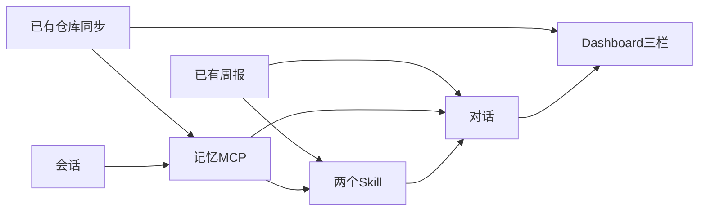

# Dashboard 先行实施方案

可以直接做。上一份顺序把 Dashboard 放在最后，是因为完整首页会调用检索、草稿执行、分析 Agent 和工作流。这四块先不进首页。对话读取已同步的仓库、Issue、PR 和周报，拉起记忆 MCP，并只注册工具都已存在的 Skill。

对照源码时只读首页里左栏、六张指标卡、对话发送和 Issue/PR 列表这几段（[DevFlow-AI/frontend/app/page.tsx](/Users/dongrudong/Downloads/projects/github-project/DevFlow-AI/frontend/app/page.tsx) 约 2470–2700 行，以及会话、聊天请求）。不要把 5900 行整页搬过来。注释里不写对标来源。

## 这次做

- 左栏：已连接仓库的项目树、展开会话、新建会话、删除会话、添加项目（复用现有连接接口）、刷新当前仓库、折叠侧栏。
- 顶上六张卡：待处理 Issue、待 Review PR、已处理 Issue、已拒绝 Issue、失败 CI、已合并 PR。前四张和已合并 PR 用本地 Issue/PR 计算。分类规则与源码一致：标签含 rejected/wontfix/invalid/duplicate 算已拒绝，accepted/resolved/done/fixed 或 closed 算已处理。失败 CI 固定为 0，因为 Actions 还没同步。
- 中间对话：选中仓库和会话后可以提问，流式看到工具过程和回答，可以停止，刷新后历史还在。本地工具五个：列出 Issue、读取一条 Issue、列出 PR、读取一条 PR（含变更文件摘要）、按日期生成周报（调用现有 [backend/src/reports/reports.service.ts](backend/src/reports/reports.service.ts)）。另外三个工具不在对话进程里实现，每次都通过 stdio 调用记忆 MCP。
- 记忆 MCP：独立进程，协议为 JSON-RPC，方法只有 `initialize`、`tools/list`、`tools/call`。服务名 `devflow-memory-mcp`。三个工具是 `devflow_search_evidence`、`devflow_get_thread_context`、`devflow_read_session_events`。它只读本次会建的会话、消息、轮次摘要，以及已经同步的 Issue 和 PR，不依赖知识库、向量、草稿、工作流或代码检出。
- Skill 只注册两个。`weekly-report` 只允许调用周报工具，数据来自现有周报服务。`project-investigation` 只允许调用四个本地读写查询和三个 MCP 工具。用户消息命中触发词时注入该 Skill 的说明，并拒绝允许列表以外的工具。
- 右栏先做 Issue、PR 两个可用页：搜索、状态、负责人、时间筛选，点开看标题和正文；PR 再看文件列表。技能与 MCP 页显示这两个 Skill，以及记忆服务是否在线和三个工具名。

## 这次不做

右栏仍保留另外五个页签，点进去只显示一句说明，不接接口：

- CI：Actions 同步还没做，没有 `workflow_runs`。
- 团队、记忆与知识库、图谱：属于项目知识。记忆页里的候选批准、笔记和上传不做；证据召回只留给对话里的 MCP 工具。

另外四个 Skill 这次不注册，因为它们的入口工具依赖还没做的模块：`issue-triage` 和 `pr-review` 依赖分析 Agent，`ci-debug` 依赖 Actions 同步和代码检出，`safety-draft` 依赖草稿。原 `project-investigation` 里的代码工作区工具和 RAG 检索同样不带进来。

对话里也不做这些能力：RAG 检索、知识库上传和笔记、操作草稿与安全确认、计划模式、工作流执行、Issue/PR/CI 分析弹层、代码工作区读文件、上下文压缩和长期记忆封存、反馈与飞书。`devflow_read_session_events` 只读已经完成的对话轮次，不做压缩边界。

## 实施步骤

后端实际端口是 `3010`，前端是 `3001`。每步验证通过再做下一步。

### 1. 读出已同步的 Issue 和 PR

在 [backend/src/repos/repos.controller.ts](backend/src/repos/repos.controller.ts) 和 [backend/src/repos/repos.service.ts](backend/src/repos/repos.service.ts) 增加：

- `GET /api/repos/:id/issues`
- `GET /api/repos/:id/pull-requests`

只返回该仓库已写入的行。PR 带上 `pr_files` 的文件名、状态、增删行数，不返回 patch 全文。仓库不存在时 404。

验证：`curl localhost:3010/api/repos/<已连接仓库 id>/issues` 返回数组，条数与库里该仓库的 Issue 一致；PR 接口同样，且每条带 `files`。

### 2. 会话

新增 `conversations` 表和 `backend/src/conversations`。字段：仓库 id、标题、状态（active/deleted）、更新时间。

- `GET /api/repos/:id/conversations`：只返回 active，按更新时间倒序。一个都没有时创建标题为「默认会话」的一条再返回。
- `POST /api/repos/:id/conversations`：正文 `{ "title": "..." }`，空标题用「新会话」。
- `DELETE /api/repos/:id/conversations/:conversationId`：标成 deleted。删光后补一条默认会话。返回剩余 active 列表。

验证：对一个仓库 GET 得到默认会话；POST 再 GET，新会话排在前面；DELETE 后再 GET，被删的不出现，且至少还有一条。

### 3. 记忆 MCP

新增 [backend/src/mcp/memory-server.ts](backend/src/mcp/memory-server.ts)，用 `node` 单独启动，经 stdin/stdout 收发一行一个 JSON。对话代码只通过 MCP 客户端调用，不把这三个函数内联进对话循环。这一步先建空的 `chat_messages` 和轮次摘要表，对话写入留到第 5 步。

工具不建向量，也不读知识库文档：

- `devflow_get_thread_context`：按 `repo_id`、`conversation_id` 读取 `chat_messages`。支持 `keyword`、`limit`、`message_id` 和字符偏移。会话不存在时返回明确错误。
- `devflow_read_session_events`：读取该会话已完成的轮次。每一轮对话结束时写一行摘要，包含用户问题、助手回答和用过的工具名。还没有完成的轮次时返回空说明，不报错。
- `devflow_search_evidence`：在当前仓库的 Issue 标题和正文、PR 标题和正文、聊天消息里做关键词匹配，返回命中片段。每次调用记一条召回记录，供以后记忆页使用；这次页面不展示它。

增加 `GET /api/mcp/status`。它拉起同一个进程，完成 `initialize` 和 `tools/list`。成功时返回 `online`、服务名和三个工具名；进程起不来返回 503。

验证：向该进程写入 `initialize` 和 `tools/list`，结果里正好是这三个名字。对已同步仓库调用 `devflow_search_evidence`，查询一条已知 Issue 标题，返回里包含该标题。

### 4. Skill

在 `backend/src/skills` 放两份说明，并做注册表。`GET /api/skills` 返回名称、标题、说明和允许的工具，不返回正文。`GET /api/skills/:name` 返回正文。未注册的名字返回 404。

- `weekly-report`：只允许 `report_agent.generate_weekly_report`。触发词包括「周报」。执行时调用现有周报服务。
- `project-investigation`：只允许 `issues.list`、`issues.get`、`pull_requests.list`、`pull_requests.get` 和三个 MCP 工具。入口是 `devflow_search_evidence`。触发词包括「以前讨论」「会话原话」。

本地查询工具用这四个固定名字，供 Skill 的允许列表引用。激活后，模型调用允许列表以外的工具时，对话返回拒绝，不执行该工具。

验证：`curl localhost:3010/api/skills` 只有这两个名字。`issue-triage`、`pr-review`、`ci-debug`、`safety-draft` 都不在列表里。`GET /api/skills/weekly-report` 的允许工具只有周报那一个。

### 5. 只读对话

新增 `backend/src/chat`，写入第 3 步建好的 `chat_messages`。一条消息保存角色、正文、工具轨迹 JSON、所属会话。一轮结束后再写轮次摘要。用现有 `ai` 和 `@ai-sdk/deepseek`，读取 `LLM_API_KEY`、`LLM_BASE_URL`、`LLM_MODEL`。

- `POST /api/chat/stream`：正文含 `repo_id`、`conversation_id`、`message`。先写入用户消息，再流式返回文本增量和工具过程，结束时写入助手消息。请求被取消时停掉生成。
- `GET /api/chat/history?repo_id=&conversation_id=`：按时间返回该会话消息和工具轨迹。

本地五个工具只查当前仓库的表，或调用已有周报服务。三个记忆工具只把参数转交给第 3 步的 MCP 进程。消息命中 Skill 触发词时，把该 Skill 的说明放进上下文，并按允许列表拒绝其他工具。不调用 GitHub，不写草稿，不做向量检索。

验证：`curl -N -X POST localhost:3010/api/chat/stream` 提问「这个仓库有多少个 open issue」，响应里能看到工具调用和最终数字，且数字与第 1 步接口一致。再 GET history，用户和助手两条都在。接着问「我刚才问了什么」，响应里出现 `devflow_get_thread_context`，回答能复述上一句。再发送「生成本周周报」，响应里出现 `weekly-report` 和 `report_agent.generate_weekly_report`，不出现 RAG 或草稿工具。不配置或配错 `LLM_API_KEY` 时接口返回明确错误，不写入一条假回答。

### 6. 首页骨架、左栏和指标卡

用 [frontend/app/page.tsx](frontend/app/page.tsx) 换掉占位页，拆成侧栏和指标卡组件。左栏走现有 `/api/repos`、连接、刷新、删除，加上第 2 步的会话接口。选中仓库后拉 Issue/PR，算出六张卡。失败 CI 显示 0。没有仓库时左栏提示先添加项目，中间不发对话请求。

验证：浏览器打开 `http://localhost:3001/`。展开仓库能看到会话；添加会话、删除会话后刷新页面仍然一致；点刷新后待处理 Issue 的数字与 `GET /api/repos/:id/issues` 里 `state=open` 的条数相同。

### 7. 右栏 Issue、PR、Skill 和 MCP

右栏默认 Issue。筛选在浏览器里做：关键词、状态、负责人、时间。点一条只展示已同步字段。技能与 MCP 页请求 `GET /api/skills` 和 `GET /api/mcp/status`。在线时列出两个 Skill、服务名和三个工具名；MCP 失败时显示 503 的说明。CI、团队、记忆与知识库、图谱四个页签可点，内容是固定说明，不发请求。

验证：在 Issue 页输入一条已知标题的关键词，列表只剩匹配项；切到 PR 能看到文件名；切到技能与 MCP 能看到 `weekly-report`、`project-investigation`、`devflow-memory-mcp` 和三个工具名；切到 CI 只看到「Actions 同步尚未接入」，网络面板没有分析或知识库请求。

### 8. 接上对话

中间输入框把当前仓库和会话发给第 5 步的流。发送时先显示用户消息，再追加助手文本和工具过程。停止按钮中止当前请求。切换会话或刷新页面时用 history 还原。空会话给出三条固定推荐句（例如查看 open issue、查看 open PR、生成本周周报），不单独做推荐接口。

验证：在首页对已同步仓库发送「列出最近的 PR」。回答过程中能看到工具名，回答里的编号能在右栏 PR 列表里找到。点停止后不再继续刷字。刷新页面后这段对话还在。
