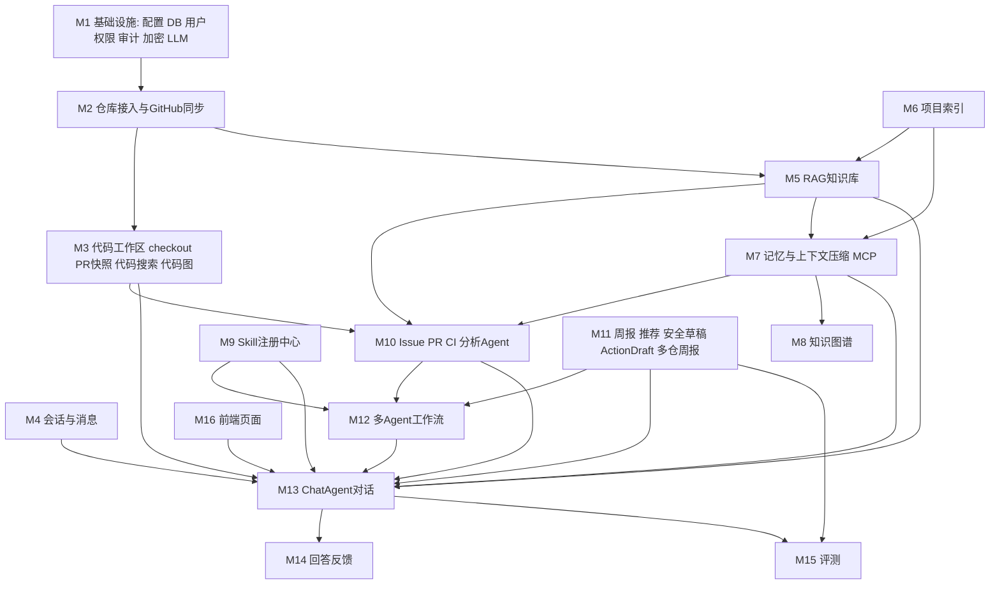
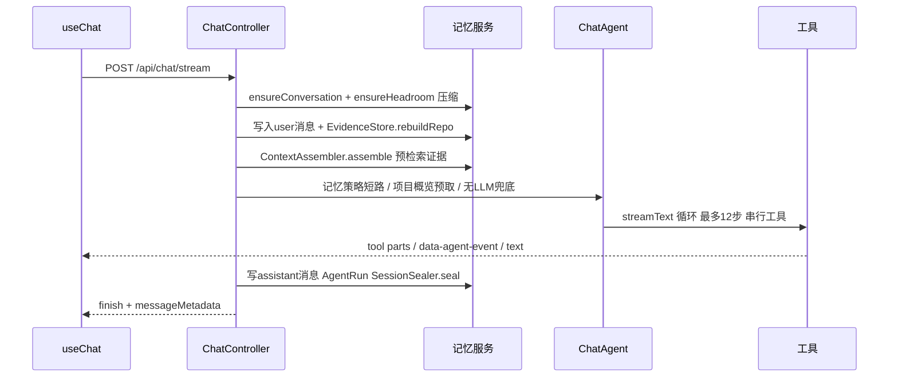

# DevFlow 全量重写方案（Next.js 16 + NestJS 11 + AI SDK 7）

本方案以 DevFlow-AI 源码为准（后端 `backend/app` 约 2.5 万行 Python，前端 `frontend` 约 1 万行），7 份分模块源码分析已整合在第 2 节。实施时每一步动手前仍需按 AGENTS.md 回读对应源码文件。

---

## 0. 技术映射与有意差异

### 0.1 技术映射

- FastAPI 路由 -> NestJS Controller；Pydantic schema -> zod schema + 自写 `ZodValidationPipe`（复用已安装的 zod 4）
- SQLAlchemy + `create_all` -> TypeORM（`synchronize: true`，开发期不做迁移，旧数据删库重建）
- Milvus -> pgvector：`documents` 表加 `embedding vector(1024)` 列，余弦检索用原生 SQL `embedding <=> $1`；BM25 关键词检索按原算法在 TS 里实现
- 本地 Qwen3-Embedding -> 百炼 `text-embedding-v4`（1024 维），通过 `@ai-sdk/alibaba` 的 `embeddingModel` + `embed/embedMany`
- `qwen3-rerank` HTTP -> 自写 `RerankingModelV4`（包装 DashScope `/reranks`），通过 AI SDK `rerank()` 调用；失败退到启发式重排（与原逻辑一致）
- `LLMClient.chat_json` -> `generateText({ output: Output.object({ schema }) })`；`chat_text` -> `generateText`；公开推理流 -> `streamText`
- LangChain/LangGraph 工具循环 -> `streamText` + `tools` + `stopWhen: isStepCount(12)` + `toolCallConcurrency: 1` + `prepareStep` + 工具 `toModelOutput`
- 自定义 SSE（thought/tool_use/tool_result/delta/final） -> AI SDK UI Message Stream（`createUIMessageStream` + `pipeUIMessageStreamToResponse`），前端 `useChat` + `DefaultChatTransport`
- MCP stdio 记忆服务 -> `@modelcontextprotocol/sdk` 写服务端（独立 Nest standalone 入口），`@ai-sdk/mcp` 的 `createMCPClient` 走 stdio 调用
- Ragas 0.4 -> 用 AI SDK 结构化输出复刻 5 项 LLM-as-judge 指标和 2 项规则指标
- Fernet token 加密 -> Node `crypto` AES-256-GCM（密钥由 `TOKEN_ENCRYPTION_KEY` 做 SHA-256 派生）
- FastAPI BackgroundTasks / asyncio 循环 -> 不 await 的 Promise（带 catch 日志）+ `@nestjs/schedule` 的 Interval
- react-markdown -> 已安装的 `streamdown`；React Query 原项目首页并未使用，继续用 `useState`/`useEffect` + 小型 `api` 客户端

### 0.2 有意差异（AI SDK 或选型带来的，其余行为保持一致）

- 最终回答由模型逐 token 流式输出；原项目是工具循环结束后把整段答案按 36 字切块再发
- 工具执行前的 `thought` 映射为：同一 step 内既有文本又有工具调用时，该 step 的文本即「公开思路」
- 下一步模型看到的工具结果由 `toModelOutput` 投影成 `{route, answer_preview, compression, citations_count}`，预算规则同原 `_summarize_observation`；原项目是把观察重新渲染进用户提示，两者语义一致
- 向量维度、模型名、collection 校验改为 pgvector 列维度与 `KnowledgeBaseConfig` 契约校验
- 源码中三处前端显示缺陷直接修正：`/workflow-runs` 读 `observation.overall_confidence`；`/evals` 的「仅重试异常评分」按钮把 `ragas: {}` 也视为缺分；`/chat` 页 `final` 不覆盖已拼接文本

---

## 1. 模块全景与关联

关键关联：

- 同步写入的 Issue/PR/CI 是 RAG 索引、证据库（EvidenceItem）、知识图谱、分析 Agent、工作流和仓库健康快照共同的数据源
- RAG 只覆盖 6 类可向量化来源：`issue`、`pull_request`、`workflow_run`、`project_doc`、`knowledge_file`、`memory_note`。源码走工作区实时搜索，不进 RAG；团队成员、周报、概览、清单只存 SQL
- 记忆系统在每轮对话前后运行：请求前压缩上下文、重建证据、组装上下文；请求后封存会话、提取记忆候选；候选批准后作为 `memory_note` 进入 RAG 和知识图谱
- 对话工具里的 Issue/PR/CI 分析只取「最新一条」（CI 取最新失败）；工作流按消息里的编号定位目标，编号不存在直接报 422
- Skill 只在两处生效：对话（显式激活会拦截未声明工具，自动激活只注入指令和 trace）和工作流专用 Agent（entrypoint 激活）。页面上的 analyze 接口不加载 Skill
- 评测在隔离事务里真实运行生产 ChatAgent 和全部工具，失败可生成 `create_issue` 草稿

一次对话请求的时序：

---

## 2. 模块详细功能说明

### M1 基础设施

- 配置：全部环境变量沿用原 `.env.example` 语义，去掉 Milvus/本地 embedding/Ragas 专属项，新增 `DASHSCOPE_API_KEY`、`RERANK_BASE_URL`、`RAGAS_JUDGE_*` 保留。关键默认值：`LLM_BASE_URL=https://api.deepseek.com`、`LLM_MODEL=deepseek-v4-pro`、`EMBEDDING_DIMENSIONS=1024`、`AUTO_SYNC_INTERVAL_SECONDS=300`、`WORKFLOW_TASK_TIMEOUT_SECONDS=90`、`REPO_CHECKOUT_DIR=.data/repos`、`UPLOAD_DIR=.data/uploads`、全部 `CONTEXT_*` 与 `RAGAS_*` 阈值
- 用户与权限：无登录。当前用户是 `users` 表最早一行，不存在则创建 `demo-owner/owner`。角色权限：owner 全部（`repo:read, repo:sync, agent:run, draft:create, draft:approve, eval:read, settings:manage`）；maintainer 去掉 `settings:manage`；developer 为 `repo:read, agent:run, draft:create, eval:read`；viewer 为 `repo:read, eval:read`；未知角色按 viewer。缺权限 403 `需要权限：{permission}`。只有 workspaces、action-drafts、evals、code-graph rebuild 检查权限
- 审计：`audit_logs` 写 `user_id, repo_id, action, target_type, target_id, status(默认 success), request_json, result_json`
- 加密：仓库 token 加密存 `repositories.github_token_encrypted`；解密失败返回 null（同步变匿名，不报错）
- LLM：统一 `LlmService`，按 `LLM_BASE_URL`/`LLM_MODEL` 选择 `@ai-sdk/deepseek` 或 `@ai-sdk/openai-compatible`；无 `LLM_API_KEY` 时结构化调用返回 null、文本调用返回空串，调用方走启发式兜底；超时 60 秒；不重试
- Token 估算 `estimateTokens`：正则 `[\u4e00-\u9fff]|[a-zA-Z0-9_\-]+|[^\s]`，汉字 1，英文词 `max(1,(len+3)//4)`，其它非空白字符 1
- 健康检查 `GET /health` 返回 `{status:"ok", app}`

### M2 仓库接入与 GitHub 同步

接口（前缀 `/api/repos`）：

- `POST /connect`：入参 `owner, repo, token`。连接成功后固定同步 Issue 和 PR，第一次每个列表最多 5 条。
  - 缺 owner 或 repo -> 400。自定义 GitHub-compatible API、以及用本机 git 目录连接，都延后到全部阶段完成后再考虑
  - 连接只保存 owner、name、token、描述和默认分支。接口固定请求 `https://api.github.com`，不存平台、接口根地址、clone 地址、本地目录和检出方式
  - 先 `GET /repos/{owner}/{repo}`；失败返回 400，且不写入仓库记录。成功后立刻同步
  - 按 `full_name` upsert；空 token 不覆盖旧 token；请求内同步（每个列表最多 5 条），再后台跑代码图分析
- `GET /`：按 `updated_at DESC`，不返回 token
- `POST /{id}/sync`：`limit` 默认 null（全量）；整体 `failed` 时 HTTP 502；无论成败后台跑代码图
- `POST /{id}/select`：只把 `updated_at` 置为当前时间
- `DELETE /{id}`：按依赖顺序硬删约 30 张关联表（分析结果、PR 文件/评论、documents、检索测试、知识源文档与配置、图谱边、索引状态、代码符号/关系、草稿、审计、反馈、记忆候选、召回、工作流、消息、会话、记忆、证据、AgentRun、会话、Issue/PR/Run），从 `workspaces.repo_ids` 移除，再删上传文件；不删本地 checkout
- `GET /{id}/sync-status`：返回 `{status, last_sync_at, message, details=sync_metadata}`；无 metadata 时为 `unknown` 或 `not_started`

同步规则：

- GitHub REST：`/repos/{o}/{r}/issues?state=all`（过滤含 `pull_request` 的项）、`/pulls?state=all`、`/pulls/{n}/files`、`/pulls/{n}/comments`。Header `Accept: application/vnd.github+json`、`X-GitHub-Api-Version: 2022-11-28`、`Authorization: Bearer`；token 空时回退全局 `GITHUB_TOKEN`。Actions 的 run、job 和失败日志延后
- 分页：`per_page=min(limit or 100,100)`，跟随 `Link rel=next`；next URL 重复或跨域即报错；limit 只计过滤后条数；截断或仍有 next -> `complete=false`
- 单源状态 `skipped/completed/empty/partial/failed`；子请求（PR 文件、评论）失败时该源降为 partial
- 总状态：全 skipped -> skipped；请求源全 failed -> failed；任一 failed/partial -> partial；有数据 -> completed；否则 empty。只有 completed/empty 更新 `last_sync_at`
- upsert 按 GitHub id；PR 文件和评论先删后插；远端删除不同步删除
- `sync_metadata = {repo_id, status, synced, sources{issues,pull_requests:{status,count,complete,pages}}, errors[], message, attempted_at, limit}`
- 定时：启动 5 秒后，每 `max(AUTO_SYNC_INTERVAL_SECONDS,30)` 秒串行同步所有 github/compatible 仓库，limit=`AUTO_SYNC_LIMIT`（默认全量）
- Webhook `POST /api/webhooks/github`：配置了 secret 才校验 `X-Hub-Signature-256`（HMAC-SHA256，失败 401）；事件属于 `issues, pull_request, push` 时后台同步，其它返回 `ignored`。`workflow_run`、`check_suite`、`check_run` 延后到 Actions 同步
- 仓库健康快照 `repositoryHealthSnapshot`：`data_status` 取 `not_synced/unknown/failed/partial/stale(>24h)/empty/ready`，仅 ready 时 `data_sufficient=true`；`status` 为 failed->error、empty->skipped、其它 success；confidence 恒 null

### M3 本地代码工作区

整段延后，待办为 later-code-graph。当前不检出仓库，也不建 `code_symbols`、`code_relations`。

- checkout 路径：当前连接没有用户目录，使用 `{REPO_CHECKOUT_DIR}/{repo.id}-{owner__name}`。用户指定本地目录（`checkout_mode=local`）延后到全部阶段完成后再做
- git（180s 超时）：已存在则 `fetch --depth 1 origin {branch}`、`checkout`、`pull --ff-only`，失败继续用旧文件；不存在则 `clone --depth 1 --branch {branch}`；HTTPS URL 注入 `x-access-token:{token}@`；托管目录非 git 时先删再 clone，用户目录不删
- 代码图 `syncCodeGraph`：最多 500 个有符号文件，单文件 180000 字节；正则提取 Python `def/class`、TS/JS `function/class/interface/type/const/let`；关系为 `imports`（from/import 语句）和 `calls`（`name(`，跳过 if/for/while/return/print/len/str/int，同文件只记一次）；按 `(repo, branch, pr_id)` 先删后写 `code_symbols`/`code_relations`
- PR 快照 `preparePrWorktree`：local 模式 `unsupported`；无 head `missing_head`；路径 `{root}/worktrees/{repoId}/pr-{n}-{owner__name}`，分支 `devflow/pr-{n}`，`worktree add --force -B`；写 `.devflow-pr-snapshot.json`；成功 `ready`，异常 `fallback`；同一 repo+pr 进程内加锁；清理默认 168 小时
- 代码搜索 `searchRepositoryCode`：查询词正则抽取，最多 16 个，停用词过滤；有 `rg` 用 `rg --json -i`（15s），否则遍历最多 1000 个文本文件；打分 = 命中词数×4 + 行内次数（每词最多 4）+ 路径次数×2，按最高分归一化；`limit` 1..50 默认 12；忽略 `.git node_modules dist build .next .venv __pycache__` 等，拒绝 `.env*`、`.npmrc`、`.pypirc`、`.log/.db/.sqlite`；路径必须在 checkout 内
- 对话用工作区工具：`list_files`（limit 默认 80，1..200，pattern 为子串）、`read_file`（start_line 默认 1，line_count 默认 160 最大 400，读上限 250000 字节）、`search_code`
- 接口：`POST /api/repos/{id}/code-graph/rebuild`、`GET /api/repos/{id}/code-symbols`、`GET /api/repos/{id}/code-graph/search`、`POST /api/pull-requests/{id}/snapshot|worktree`、`POST /api/repos/{id}/pr-snapshots/cleanup`

### M4 会话与消息

- `GET /api/repos/{id}/conversations`：只返回 active，按 `updated_at DESC`；没有则建「默认会话」，并把无会话的消息/会话段/AgentRun 挂到最早会话
- `POST`：标题为空时，仓库会话数（含已删）为 0 用「默认会话」，否则「新会话 N+1」
- `DELETE`：软删 `status=deleted`，硬删该会话的反馈、记忆候选、召回、工作流、消息、会话段、AgentRun、会话记忆、证据；删光后补建默认会话；返回 `{deleted, active_conversation_id, conversations}`
- `ensureConversation`：传入 id 不属于该仓库或非 active 时落到默认会话
- `touchConversation`：首条消息且标题以「默认会话/新会话」开头时，标题改为消息前 40 字；`message_count += 2`
- 无重命名接口

### M5 RAG 知识库

- 知识库边界即仓库，`knowledge_base_configs` 每仓一行：`embedding_provider/model/dimensions`（必须等于环境契约，否则 409）、`retrieval_method=hybrid`（vector/fulltext/hybrid）、`rerank_enabled=true`、`rerank_provider=qwen_api`、`rerank_model=qwen3-rerank`、`top_k=3`、`score_threshold_enabled=true`、`score_threshold=0.8`、`chunk_size=800`、`chunk_overlap=100`
- 上传（异步）`POST /api/rag/repositories/{id}/documents`：12MB 上限；后缀 `.txt .md .markdown .mdx .pdf .docx .json .csv .log`，否则 415；SHA-256 去重（失败记录不算重复）；状态 `queued -> parsing -> splitting -> embedding -> completed|failed`；文件存 `{UPLOAD_DIR}/{repoId}/{docId}-{name}`；embedding 每批 64，输入 `title\ncontent`；`retry` 重置为 queued
- 解析：PDF 最多 500 页，每页加 `<!-- page: N -->`；DOCX 先做 zip 安全检查（条目 10000、解压 64MB、加密拒绝），标题、列表、表格转 Markdown；其它文本按 utf-8-sig/utf-8/gb18030/latin-1 解码，前 8192 字节含 NUL 拒绝；文本上限 4000000 字符
- 切片 `chunkDocument(text, path, maxChars, overlap)`：csv 按行并重复表头；md/pdf/docx 按标题栈与代码围栏分块、同 section+page 合并、标题前缀、句边界 overlap、代码块不参与 overlap；json 按 `$.key`/`$[i]`；其它滑窗；单文档最多 5000 块；`parent_id/chunk_id` 为 SHA-256 前 24 位
- 来源策略：可向量化 6 类（见第 1 节）；`project_overview, project_manifest, team_member, weekly_report, chat_session, conversation_memory, thread_memory` 只存 SQL；`code_file` 禁止写入
- 混合检索 `searchSimilarDocuments`（默认 hybrid、limit 5、rerank、压缩）：`fetch_limit=min(max(limit*8,40),200)`；向量为 pgvector 余弦，按候选最大值归一化；BM25 为 `k1=1.5, b=0.75`，字段权重 title 4、path 3、symbol 4.5、labels 2.5、content 1，中文整段加 2-gram；融合 `min(1, 0.62*v + 0.30*k + (双路命中 0.08))`；按规范化文本哈希或 Jaccard 0.9 去重；同 parent 最多 2 条；metadata 过滤支持 label/state/path/module/日期/branch
- Rerank：DashScope `{model, query, documents(每条截 4000), top_n, instruct}`；失败用启发式：`0.31*base + 0.20*vector + 0.16*keyword + 0.17*coverage + 标题/路径命中 + 整句命中 0.12 + 多词命中 0.08 + 双路 0.05 + 新鲜度(30天 0.04, 180天 0.02) + 类型命中 0.03`
- `retrieveKnowledge`：候选 `min(max(top_k*(rerank?8:2),20),100)` -> 重排截 top_k -> 父块前后各 1 个邻居扩展 -> 分数阈值 -> 压缩（总预算 `min(1800,max(520,top_k*260))`，单条 260 token，按查询摘句）-> answer gate
- Answer gate：无结果或最高分低于阈值或强信号词未出现 -> `insufficient_evidence`；两条 ≥0.6 证据极性相反（允许/禁止、成功/失败、必须/可选）-> `conflict`；指代词且问题过短或来源多于 1 -> `ask_clarification`；否则 `answer`
- 问答 `POST /api/rag/{id}/ask`：gate 不通过不调 LLM；系统提示要求只依据 `<knowledge>`、事实后标 `[n]`、不足时说「当前知识库资料不足，无法确认」；无 LLM 或空回答走抽取式兜底（最多 4 句）；返回 `generation_mode: llm|extractive|no_evidence`
- 其它接口：`GET /api/rag/models`、`GET /api/rag/repositories[/{id}]`、`PATCH .../config`（overlap ≥ size 400）、`GET .../documents`、`GET .../documents/{docId}/chunks`、`DELETE .../documents/{docId}`、`POST|GET .../retrieval-tests`（写 `retrieval_test_runs`，含完整 pipeline trace）、`GET /api/rag/{id}/status`、`POST /api/rag/{id}/search`、`POST /api/rag/{id}/reindex`、`POST /api/search`
- 仓库对象索引：Issue（`title\nbody`）、PR（标题、正文、review 评论，不含 diff）、失败 CI 日志（脱敏后 8000 字一块，最多 6 块）；脱敏覆盖私钥、`gh*_` token、AKIA、JWT、Bearer、`::add-mask::`、key/token/secret/password 赋值
- reindex：重写 Issue/PR/CI 文档 -> 删 4 类不该存在的文档 -> RAG 文档重新 embed -> 全量写回向量

### M6 项目索引（memory-index）

- `project_index_states` 状态：`missing/stale/building/ready/failed`；读取时 ready 但指纹变化则返回 stale
- 指纹：`.devflow/index.yml` 策略 JSON + 最多 1000 个候选文件的 `path+mtime+size` 的 SHA-256
- 扫描：`docs/**.md`、README/ARCHITECTURE/CONTRIBUTING/ADR*（authoritative）、CHANGELOG/HISTORY/RELEASES/ISSUE_TEMPLATE（soft_clue）为 `project_doc`；package.json、pyproject.toml 等 11 种清单为 `project_manifest`；另写一条 `project_overview`；切片 1800/180；扫描不生成向量（需 reindex 后才进向量）
- 接口：`GET /api/repos/{id}/memory-index/state`、`POST .../scan`（202，置 building，后台扫描）、`POST .../snooze`（默认 7 天，1..30）
- 扫描成功后重建证据库和知识图谱

### M7 记忆与上下文压缩

- MessageStore：`chat_messages` 读写；`recent` 投影 = 最近压缩边界 + `preserved_message_ids` 原消息 + 边界后的新消息
- EvidenceStore：每轮对话前 `rebuildRepo` 删除并重建 `evidence_items`（仓库描述、全部 Issue、PR、失败 CI 日志、RAG 文档、会话记忆、最近 30 条会话摘要、最近 30 条 AgentRun）；`search` 先跑混合 RAG（至少 8 条），再对最多 500 条证据做关键词打分补齐，摘录 90 token
- ContextAssembler：默认 limit 16、实际拉 30 条历史；系统段依次为 `[Current Repository]`、`[Current Conversation]`、`[Rehydrated Working State]`、`[Compaction Boundary]`、`[Thread Memory: N sessions]`、`[Previous Session Digest]`、`[Related Evidence]`（最多 8 条）；输出 `server_context, server_messages, evidence, compression_stats, history_coverage`
- 预算：模型窗口表（deepseek-v4-pro 1000000/384000、gpt-4o 128000、gpt-5 400000、claude-sonnet-4 200000 等）；动态窗口开启时 `max_input=max(24000, 窗口)`；保留 `max(512,min(3000,max_input//2))`；比例 system 0.12、memory 0.22、evidence 0.34、recent 0.22、tool 0.10，每段至少 512
- 压力阶段：buffer 20000/13000/8000/3000 按窗口比例缩小，得出 `warning/auto_compact/aggressive/manual_path` 四条线
- microcompact：达到 warning 时把保留最近 8 条之前、可再生成工具结果（workspace/rag/devflow_search_evidence/repo_health/ci_debug 等）替换为 `[Old regenerable tool/context result cleared by microcompact]` + 90 token 摘录，不写库
- full compact（`ProgressiveContextManager.ensureHeadroom`，用户消息入库前）：跳过条件依次为关闭、microcompact 已足够、压力仅 warning、连续失败达 3 次熔断；计划 auto（保留 8、摘要 1800）/aggressive（4、1206）/manual（2、900）逐级加码；摘要来源优先已有会话记忆，其次 LLM（`COMPACT_SUMMARY_SYSTEM_PROMPT` 五段式），最后抽取式兜底；补充最多 12 条遗漏的路径、命令、错误；写入 `role=system, route=context_compaction, meta.subtype=compact_boundary` 消息，不删原文；失败写 `compact_failure`
- 运行时溢出：模型报上下文过长时 aggressive 再砍一次，只重试一次
- SessionSealer：每轮结束先写 `chat_sessions(status=sealing)` 和原始 transcript；LLM 生成完整记忆快照 JSON（digest、summary、facts、decisions、open_questions、tasks、user_preferences、repo_context、citations），失败用规则兜底；有会话写 `conversation_memories`，否则写 `thread_memories`；上限 facts/decisions/tasks/repo_context 16、open_questions/preferences 12、citations 末 16 条、summary 1100 token；最终 `sealed` 或 `sealed_with_warnings`
- 记忆候选：从 decision/fact/task/preference/repo_context 生成 `memory_candidates(pending)`，同内容已有 pending/approved 则跳过；批准 -> 写 `memory_note` 文档（进向量）+ 重建证据与图谱；拒绝只改状态
- 召回事件 `recall_events`：RAG 工具、工作流 RAG 任务、MCP 三个工具、手动搜索写入，结果与引用各保留 12 条
- MCP 记忆服务 `devflow-memory-mcp`（协议 2024-11-05，stdio）：`devflow_search_evidence`（query 必填，limit 默认 5 最大 20）、`devflow_get_thread_context`（跨压缩边界读原文，limit 默认 30、max_chars 默认 6000）、`devflow_read_session_events`（limit 默认 5、max_chars 默认 8000、include_transcript 默认 true）；对话侧每次调用拉起子进程，30 秒超时
- 知识/团队/记忆接口（前缀 `/api/repos`）：`GET /{id}/knowledge`、`POST /{id}/knowledge/notes`、`POST /{id}/knowledge/upload`（同步切片 1800/180）、`DELETE /{id}/knowledge/{sourceId}`、`GET|POST /{id}/team-members`、`DELETE /{id}/team-members/{mid}`、`GET /{id}/memory/search`、`GET /{id}/memory/recall-events`、`GET /{id}/memory/status`、`GET /{id}/memory/candidates`、`POST .../approve|reject`

### M8 知识图谱

- 节点类型：issue、pull_request、ci_run、team_member、memory_note、document、code_file、session_decision
- 边：`assigned_to`（Issue->成员）、`resolves`（PR 正文 fix/close/resolve #N）、`mentions`、`touches_file`（PR->文件）、`failed_in_ci`（日志里 PR #N 置信度 0.85，#N 0.75）、文档/记忆对 Issue/PR/文件的 `mentions/cites/documents`（0.75/0.8）、会话决策 `cites`（0.75，记忆 citations 0.9）、`used_as_evidence`（最近 25 条 AgentRun 工具引用）
- 重建：先删全部边再全量生成，同五元组取最大置信度；查询无边时自动重建
- 查询：depth 1..2 无向 BFS；无中心时按 issue < PR < ci < 成员 < 记忆 < 决策 < 文档 < 文件排序；最多 72 个节点；`used_as_evidence` 目标高亮
- 接口：`GET /api/repos/{id}/knowledge/graph?center_type&center_id&depth`、`POST .../knowledge/graph/rebuild`

### M9 Skill 注册中心

- 加载 `skills/*/SKILL.md`，frontmatter 字段：`name, title, version, description, category, entrypoint, tools, input_modes, triggers, workflow_steps, output_contract, safety_level`；name/entrypoint 唯一
- 6 个 Skill 原样复制：ci-debug、issue-triage、pr-review（含 `references/risk-checklist.md`）、project-investigation、safety-draft、weekly-report
- 激活：显式（`requested_skill` 或消息含 skill/技能且点名，找不到报错）；自动（trigger 命中加 `max(1,min(len,8))`，最多 3 个）；entrypoint（工作流专用 Agent）
- 资源：正文反引号路径限 `references/ templates/ scripts/ assets/`，最多 8 个，每个 ≤64KiB；digest 取 SHA-256 前 16 位；进提示词截到 6000 token
- 校验结果 `violated/completed/failed/not_executed`
- 接口：`GET /api/skills`、`GET /api/skills/mcp-status`（真实执行 initialize + tools/list，失败 503）、`GET /api/skills/{name}`

### M10 分析 Agent（Issue / PR / CI）

公共规则：上下文由路由拼好；有 LLM 时结构化输出，再与启发式结果合并（LLM 覆盖、列表为空用兜底、非法负责人回退）；无 LLM 或校验失败用启发式；每次分析新增一行 `analysis_results`。

- IssueAgent
  - 上下文：相似 Issue（RAG，limit 4，排除自身）、代码（limit 4）、项目文档（knowledge_file/memory_note/project_doc，limit 4）、会话证据（5 条）、团队成员
  - 输出字段：summary、conclusion（进入开发/等待澄清/关闭/拆分/合并到已有 Issue）、conclusion_reason、category（7 类）、priority（P0..P3）、complexity（S/M/L/XL）、suggested_owner、owner_reason、duplicate_candidates、evidence、checklist、action_items、drafts、confidence
  - 启发式：按关键词顺序分类（默认 Feature）、优先级（默认 P2）、复杂度、结论（duplicate ≥0.86 合并、XL 或多项拆分、信息不足等待澄清）
  - 负责人：已有 assignee 优先；否则按团队画像词匹配 +1、领域规则 +8 取最高正分；否则「待分配」
  - confidence：0.45 起加分，夹在 0.35..0.86
- PRReviewAgent
  - 上下文：前 12 个文件 diff、review 评论、代码（limit 6）、文档、相关 Issue、最近 8 条 CI；PR 快照就绪时合并快照代码搜索与代码图影响面
  - 输出：plan、executed_steps、key_changes、risk_points、blocking_issues、review_findings（severity P1/P2/P3、blocking）、review_checklist、test_suggestions、files_need_attention、merge_recommendation（建议合入/修改后合入/暂缓/拒绝）
  - 规则：有 P1/P2 时不得「建议合入」，强制改「修改后合入」；启发式覆盖失败 CI、敏感文件、未处理评论、大 diff、缺测试
- CIDebugAgent
  - 上下文：失败 job/step、首个错误片段（前 2 行 + 后 5 行，最多 900 字）、相关文件（最多 8）、workflow 配置、最近 5 个 PR、关联 PR 快照
  - 输出：failure_summary、failure_type（test/build/lint/dependency/permission/environment/unknown）、first_error、root_cause、possible_causes、fix_steps、debug_steps、related_files、is_merge_blocking、blocking_reason、confidence
  - 分类顺序：permission -> environment -> dependency -> lint -> build -> test -> unknown
- 接口：`GET /api/repos/{id}/issues`、`GET /api/issues/{id}`、`POST /api/issues/{id}/analyze[/stream]`、`GET /api/issues/{id}/similar`；PR 同构（另有 snapshot、review-checklist），analyze 默认 `use_pr_snapshot=true`；CI 为 `GET /api/repos/{id}/workflow-runs`、`GET /api/workflow-runs/{id}[/failed-jobs]`、`POST .../analyze[/stream]`
- 流式分析：先 `streamText`（公开推理提示词，只输出步骤不输出 JSON；无 LLM 时本地 4 行模板），再执行分析并输出结果

### M11 周报、推荐、安全草稿、ActionDraft、多仓周报

- ReportAgent（不调 LLM）：时间窗两端包含（UTC 00:00 到 23:59:59.999）；Issue 任一 created/updated/closed、PR 任一 created/updated/merged、Run 任一 created/updated 落在区间；Markdown 章节为数据概览、本周完成、进行中、风险与阻塞、需要关注的 PR、失败 CI、下周建议；写入 `weekly_report` 文档
- `POST /api/reports/weekly`、`POST /api/reports/repo-health`（忽略日期，返回 demo 指标）
- RecommendationAgent（不调 LLM）：生成 4..5 条对话推荐问句，按失败 CI -> 最近 CI -> open PR -> open Issue -> 汇总的顺序，`exclude` 去重，空仓库给 7 条初始化问句；`POST /api/chat/recommendations`
- SafetyAgent（不调 LLM）：action 命中写类 token（comment/create_issue/label/close_issue/send_report/write/post/send/评论/创建/新建/发给/发送/改标签/关闭/写回）时 `requires_confirmation=true, risk_level=medium`，否则 low
- ActionDraft 状态机：`pending_confirmation` -> cancel -> `cancelled`；confirm 成功 -> `executed`；confirm 抛错 -> `failed`。确认即执行，不再走 Safety
  - 执行分支：`issue_comment/pr_comment/comment` -> `POST issues/{n}/comments`；`create_issue` -> `POST issues`；`close_issue` -> `PATCH issues/{n}`；`label/add_label/add_labels` -> `POST issues/{n}/labels`；`send_report` -> 仅记录不调外部；其它 -> failed
  - 审计动作：`action_draft.create`、`action_draft.create_from_chat`、`action_draft.cancel`、`action_draft.confirm.{type}`
  - 接口：`GET /api/action-drafts?repo_id&status`（最多 100）、`POST /api/action-drafts`、`GET /{id}`、`POST /{id}/confirm|cancel`、`GET /audit-logs`（需 settings:manage）
- 多仓周报 `POST /api/workspaces/multi-repo-report`：风险 high（失败 CI>0 或 open PR>5）/medium（open Issue>5）/low；每个仓库写一份 weekly_report；`POST|GET /api/workspaces`

### M12 多 Agent 工作流

- Planner（规则）：`WorkflowSpec{workflow_id=workflow_{uuid12}, goal, max_parallel_tasks=3, requires_human_confirmation, tasks[], acceptance_criteria(固定 6 条)}`；task_type 为 `repo_health, issue_analysis, pr_review, ci_debug, rag_search, safety_review`；按消息关键词和宽问 token 决定加入哪些任务；消息里多个编号 422，编号不存在 422，未写编号用最新 Issue/PR/最新失败 CI
- 执行：就绪任务每波最多 `max_parallel_tasks` 个并发；单任务超时 90 秒（`error_kind=timeout`）；依赖失败下游 `skipped`；未注册类型 skipped
- 专用任务按 entrypoint 激活 Skill，把 `skill_instructions` 放进上下文；repo_health 用健康快照；rag_search 直接检索并写召回事件
- Observer（规则）：`task_error/task_skipped/evidence_gap/low_confidence/ci_merge_gate/pr_blocking_issues/cross_agent_conflict/owner_needs_review/team_profile_missing/missing_safety_review/human_confirmation_required`；overall_confidence = 成功任务均值（无则 0.55）- 0.2×blocker - 0.05×warning，夹 0.1..0.95
- 重规划：默认 1 次（0..2），只追加 safety_review/rag_search/ci_debug，任务图不变即停止
- Synthesis（规则）：固定 6 段 Markdown（协作结论、任务图、Agent 输出摘要、Observer 检查、决策依据与待确认项 8 条、下一步 6 条）
- 持久化：`agent_workflow_runs(spec_json, observation_json, final_answer, metrics, status=error|partial|success)` + `agent_task_runs(claim_json, input_json={objective,dependencies}, result_json)`；metrics 含 duration_ms、task_count、execution_rounds、replan_count、success/error/skipped_count、observer_findings、workflow_run_id
- 接口：`POST /api/chat/plan`（只规划，不落消息）、`POST /api/chat/plan/execute/stream`、`GET /api/chat/workflow-runs`

### M13 ChatAgent 对话（核心）

- 请求：`{repo_id, conversation_id, message, context}`；服务端忽略客户端传来的 `repo_id, conversation_id, tools, server_context, evidence` 等保留键
- 进入循环前的短路（顺序执行）：Skill 激活失败 -> `skill_error`；最近历史已完整覆盖 -> 直接回答（`direct_answer`，不调工具）；记忆策略要求某个 MCP 工具 -> 先执行该工具再回答；项目概览类问题 -> 预取 `list_files` 与 README/package.json/SETUP.md 再回答；无 LLM -> 用预检索证据回答（`prefetched_evidence`）或固定提示
- 14 个工具：`workspace.list_files`、`workspace.read_file`、`workspace.search_code`、`repo_health.generate_summary`、`rag.search_similar_documents`、`issue_agent.analyze_issue`（最新 Issue）、`pr_review_agent.analyze_pr`（最新 PR）、`ci_debug_agent.analyze_workflow_run`（最新失败 CI，没有则退回健康快照）、`report_agent.generate_weekly_report`、`safety_agent.classify_action_risk`（写 ActionDraft 和审计）、`workflow.run_engineering_review`、`devflow_search_evidence`、`devflow_get_thread_context`、`devflow_read_session_events`（后三个走 MCP）。工具名中的点号在模型侧替换为 `__`，对外仍显示原名；统一返回 `{route, tool_calls, answer, citations}`
- 循环约束：最多 12 次模型决策；同一工具+规范化参数第 3 次调用即停止（`tool_loop_guard`）；可重试错误（timeout/rate_limited/transient_network）重试 1 次，safety/report/workflow 永不重试；显式 Skill 未声明的工具拒绝执行（`permission_denied`）；工具串行执行
- 提示词：稳定系统前缀（对话控制器职责、证据规则、负责人只能来自团队或 assignees、写操作只出草稿、跨域决策优先工作流）+ 动态用户段（记忆工具使用规则、混合 RAG 规则、Skill 目录与本轮完整指令、团队、server_context、history_coverage、最近消息）
- route 取最后一次成功工具的 route；`completion = {status: completed|completed_with_tool_errors|blocked|budget_exhausted, reason, steps, tool_call_count, tool_error_count}`
- 持久化：assistant 消息（meta 含 run_id、agent_events、model_usage、context_diagnostics、compression_stats、progressive_compaction、UI parts）、`agent_runs`、`touchConversation`、`SessionSealer.seal`；异常时写 `route=error` 消息与 `AgentRun.status=error`
- 用量：`model_usage[]` 记录 input/output/total/cache_read/cache_creation tokens、phase、source（provider 或 estimate）
- 接口：`POST /api/chat`（非流式）、`POST /api/chat/stream`、`GET /api/chat/history?repo_id&conversation_id&limit&before_message_id`
- 流协议映射：工具调用 -> `tool-*` parts；`skill_activated/rag_strategy/context_policy/tool_retry/agent_loop_stop/skill_validation` -> `data-agent-event` parts；结束时 `messageMetadata` 携带 run_id、message_id、route、completion、model_usage、context_diagnostics、compression_stats、progressive_compaction、tool_calls

### M14 回答反馈

- `POST /api/chat/feedback`：一条助手消息一条反馈；helpful 不能带 reason，直接 `resolved` + `not_applicable`；unhelpful 的 reason 取 `inaccurate/not_relevant/missing_context/unreliable_citation/tool_error/other`，评论 ≤1000 字，首次或从 helpful 变 unhelpful 时 `review_status=open` 并发飞书
- 飞书：`{"msg_type":"text","content":{"text":...}}`，5 秒超时；`notification_status` 为 `pending/sent/failed/not_configured/not_applicable`
- `PATCH /{id}` 人工复核（open/in_review/resolved/dismissed）；`GET /` 列表；`GET /metrics`；`GET /trace/{run_id}` 返回仓库、会话、反馈、run、消息对、会话段

### M15 评测

- 基础评测 `POST /api/evals/run`（同步，三个分析 Agent 走启发式）：Issue 分类 3 题、PR 关键文件覆盖 1 题、RAG hit@3（128 维确定性向量）、CI pytest 识别、工具 schema 就绪度（恒 1）、Skill 覆盖与入口准确率、结构化输出校验、上下文压缩统计
- RAGAS 评测 `POST /api/evals/rag/run`：立即返回 queued，后台执行；用例来源为 API cases（规范化 JSON 哈希）、固定评测集文件 `docs/datas/evals/*.json`（原始字节哈希）或自动冒烟（按 Top-K 从文档出题）
- 每题在事务 savepoint 中新建隔离会话，重建证据、组装上下文、运行生产 ChatAgent（`evaluation_mode`），收集预检索和工具二次检索的 contexts/sources，结束回滚
- 检索指标（规则）：recall@k、precision@k、MRR、nDCG
- 硬规则：来源命中、必需工具、工具无错误、有回答、有上下文、必含/禁含短语、答案正则
- Judge 指标（AI SDK 结构化输出，温度 0，单指标 120 秒）：context_precision（逐条 context 判定，平均精度）、context_recall（拆 reference 语句判定归因）、faithfulness（拆回答声明 + NLI，按 700 字分块加权，并发 2）、answer_relevancy（反向生成 1 个问题，与原问题 embedding 余弦，回避回答置 0）、agent_goal_accuracy（推断 end_state 与 reference 二值比较）；tool_call_accuracy 与 tool_call_f1 为规则计算，仅用例写了 `expected_tool_calls` 时计分
- 阈值：0.75 / 0.80 / 0.90 / 0.80 / 0.80 / 0.90 / 0.90；状态判定 `passed/failed/error/partial/no_cases`，并区分 `execution_status` 与 `quality_status`
- 诊断类别：judge_error、retrieval、generation、retrieval_noise、retrieval_recall、generation_faithfulness、generation_relevancy、agent_goal、passed
- 其它接口：`GET /api/evals/suites`、`POST /api/evals/{id}/rescore`（复用现场只重算缺失/失败指标）、`GET /api/evals/compare`（哈希、Ragas 版本、Judge、Top-K 四项一致才可比）、`POST /api/evals/{id}/issue-draft`（生成 `create_issue` 草稿）、`GET /api/evals`、`GET /api/evals/{id}`

### M16 前端页面

- 全局：顶栏导航（Dashboard、项目知识、RAG 工作室、Repos、Drafts、Runs、团队工作区、研发周报、Code Graph、Evals）；配色 `ink #17212b`、`panel #f7f9fb`、`line #d8e0e8`、`accent #0f766e`；不使用 localStorage
- `/` Dashboard：左栏 300px/56px（项目树、会话列表、添加项目、刷新）；中间顶部 6 张指标卡 + 消息区 + 输入区（推荐问句、计划模式开关、发送/停止）；8px 拖拽条；右栏 360..640（默认 420）共 7 个 tab：Issue、PR、CI、团队、记忆&知识库、技能&MCP、图谱
  - 会话：新建只生成草稿 id，首条消息才创建；删除需确认；无重命名
  - 消息：用户气泡 `#ffd9ca` 纯文本；助手 Markdown；底栏 route/工具数/失败数；工具过程折叠条；上下文诊断折叠卡；反馈按钮
  - 计划模式：`/api/chat/plan` 生成计划卡，点击执行走 `/api/chat/plan/execute/stream`
  - Issue/PR 分组规则、筛选（关键词、状态、负责人、7/30 天）、详情、分析弹层（左 280px trace、右结果）
  - 记忆面板：召回记录、搜索、状态、待确认知识（批准/拒绝）、笔记与文件上传、索引扫描提示卡（空会话且未 ready 时显示，可延后 7 天）
  - 图谱：SVG 720×420 环形布局，聚焦与打开
- `/chat`：简易调试页
- `/repos`、`/workspaces`、`/issues`、`/pull-requests`、`/ci`、`/reports`、`/action-drafts`、`/workflow-runs`、`/knowledge`、`/knowledge/[id]`（文档/召回测试/设置三个 tab，未完成文档每秒轮询）、`/rag`（三栏问答工作室）、`/code-graph`、`/evals`（RAGAS 质量工作台，进行中每 2 秒轮询）

---

## 3. 数据模型

30 张表按原结构用 TypeORM Entity 定义（UUID 主键、JSON 列用 `jsonb`、时间 `timestamptz`）：`users, repositories, workspaces, project_index_states, conversations, issues, pull_requests, pr_files, pr_review_comments, workflow_runs, analysis_results, documents, knowledge_base_configs, knowledge_source_documents, retrieval_test_runs, code_symbols, code_relations, chat_messages, chat_sessions, thread_memories, conversation_memories, evidence_items, knowledge_graph_edges, recall_events, memory_candidates, agent_runs, chat_feedback, agent_workflow_runs, agent_task_runs, eval_runs, action_drafts, audit_logs`。

与原结构的唯一差异：`documents` 增加 `embedding vector(1024)`（可空，只有 6 类 RAG 来源写入）以及 HNSW 余弦索引；`metadata` 列在实体中命名为 `meta`、列名保留 `metadata`。

---

## 4. 工程结构

后端 `backend/src`：

- `config/`（环境变量 zod 校验）、`common/`（ZodValidationPipe、权限装饰器与守卫、审计、加密、token 估算、UI 流辅助）
- `database/entities/*.entity.ts`、`database/database.module.ts`
- `modules/llm`、`modules/github`、`modules/repos`、`modules/workspace-code`（checkout、搜索、代码图、PR 快照）、`modules/conversations`、`modules/rag`、`modules/project-index`、`modules/memory`（context-compression、message-store、evidence-store、context-assembler、progressive-context、session-sealer、memory-hub）、`modules/knowledge`（知识、团队、图谱）、`modules/skills`、`modules/agents`（issue、pr-review、ci-debug、report、recommendation、safety、planner、observer、synthesis、orchestrator）、`modules/analysis`（issues/pull-requests/ci/reports 路由）、`modules/action-drafts`、`modules/workspaces`、`modules/chat`（tools、chat-agent、controller）、`modules/feedback`、`modules/evals`、`modules/webhooks`
- `mcp/memory-server.ts`（独立入口）、`skills/*/SKILL.md`

前端 `frontend`：

- `app/` 下 15 个路由；`components/layout/app-shell.tsx`；`components/dashboard/*`（sidebar、chat-panel、message-item、trace-inline、context-diagnostics、workflow-plan-card、workspace-tabs、analysis-overlays、memory-hub、knowledge-graph、add-project-dialog）；`components/feedback-controls.tsx`；`components/rag/retrieval-settings.tsx`
- `lib/api.ts`（GET/POST/PATCH/DELETE/上传、错误解析）、`lib/types.ts`、`lib/chat-transport.ts`

---

## 5. 分步实施（每步完成后立即验证，验证不过不进入下一步）

约定：后端 `cd backend && pnpm start:dev`（端口 8000），前端 `cd frontend && pnpm dev`（端口 3000）。纯算法函数配 jest 单测。每一步动手前回读括号中的 DevFlow-AI 源码。

### 阶段 0：基础设施

1. 数据库与配置（`docker-compose.yml`、`scripts/init_pgvector.sql`、[backend/src/config](backend/src/config)、`.env.example`）
   - 做法：pgvector/pg16 容器与 `CREATE EXTENSION vector`；`@nestjs/config` + zod 校验全部环境变量；`main.ts` 端口 8000、CORS（开发期放行 localhost 任意端口）、`GET /health`
   - 验证：`docker compose up -d postgres` 后 `curl localhost:8000/health` 返回 `{"status":"ok"}`；删掉必填变量时启动失败并提示变量名
2. 全部 Entity（`backend/src/database/entities`，对照 `db/models.py`）
   - 做法：30 张表、外键、索引、`documents.embedding vector(1024)` 与 HNSW 索引；`synchronize: true`
   - 验证：启动后 `psql -c '\dt'` 列出 30+ 张表；`\d documents` 能看到 `embedding vector(1024)`
3. 公共能力（`common/`、`modules/llm`，对照 `core/security.py`、`services/permissions.py`、`llm/client.py`、`context_compression.py` 的 estimate/clip）
   - 做法：当前用户与权限守卫、审计写入、AES-256-GCM 加解密、`LlmService`（structured/text/stream、无 key 兜底）、`estimateTokens`/`clipToTokenBudget`
   - 验证：jest 覆盖加解密往返、错误密钥返回 null、token 估算样例（中英混合）；临时调试接口调用 `LlmService.structured` 有 key 返回对象、无 key 返回 null
4. 前端骨架（`frontend/app/layout.tsx`、`components/layout/app-shell.tsx`、`lib/api.ts`、`lib/types.ts`、`globals.css`）
   - 做法：顶栏 10 个导航、颜色 token、`NEXT_PUBLIC_API_BASE_URL`、错误解析（`detail`/`message`/网络失败中文）
   - 验证：`pnpm typecheck && pnpm lint` 通过；打开首页可见导航，后端停掉时调用显示「无法访问后端 API…」

### 阶段 1：仓库、同步与代码工作区

5. GitHub 客户端与同步服务（`modules/github`，对照 `services/github/*`、`repos_sync.py`）
   - 做法：分页、limit 语义、单源与总状态判定、upsert、PR 文件评论先删后插、日志 zip 解析与 80000 截断、`sync_metadata`
   - 验证：jest 用本地 http server 模拟分页（3 页、limit 截断、next 跨域报错、子请求失败降 partial）；断言状态与入库条数
6. 仓库接口、定时同步、Webhook（`modules/repos`、`modules/webhooks`，对照 `routes/repos.py`、`scheduler.py`、`webhooks.py`）
   - 验证：`curl -X POST /api/repos/connect -d '{"owner":"vercel","repo":"ai","token":"..."}'` 返回 `sync_status=completed` 且每类 5 条；`POST /api/repos/{id}/sync` 带 `limit:null` 全量；`GET /sync-status` 字段齐全；无签名请求在设置 secret 后返回 401；`DELETE` 后关联表计数为 0
7. 代码工作区（`modules/workspace-code`，对照 `worktree_manager.py`、`code_search.py`、`code_analysis.py`、`routes/code_graph.py`）
   - 做法：checkout/浅克隆/更新、代码图正则提取、PR 快照与清理、代码搜索（rg 与遍历两种实现）、路径安全校验
   - 验证：连接后 `.data/repos/{id}-...` 出现代码；`POST /api/repos/{id}/code-graph/rebuild` 返回 `indexed_symbols>0`；`GET /code-graph/search?q=xxx` 返回符号与片段；jest 验证 `../` 越界与 `.env` 被拒
8. 前端 `/repos`（对照 `frontend/app/repos/page.tsx`）
   - 验证：页面用所有者和仓库名连接一个 GitHub 仓库，结果 JSON 显示；「设为当前查看」后列表顺序变化；「立即刷新」与删除可用

### 阶段 2：RAG 知识库与项目索引

9. 文档解析与切片（`modules/rag/document-extraction.ts`、`chunking.ts`，对照 `document_extraction.py`、`chunking.py`）
   - 做法：pdf（`unpdf`）、docx（`jszip` 安全检查 + `mammoth` 转 HTML + `turndown` 转 Markdown）、文本解码；`chunkDocument` 全部分支
   - 验证：jest 覆盖 markdown 标题栈、代码围栏不切开、csv 表头重复、json 路径、overlap 边界、5000 块上限，以及 chunk_id 稳定性
10. Embedding、Rerank、pgvector 存储（`modules/rag/embeddings.ts`、`rerank.ts`、`vector-store.ts`，对照 `embeddings.py`、`rerank.py`、`vector_store.py`）
    - 做法：`@ai-sdk/alibaba` 的 `embeddingModel('text-embedding-v4')` + 维度校验；自写 `RerankingModelV4` + `rerank()` + 启发式兜底；向量写入、删除、按 repo/source_type 过滤搜索
    - 验证：临时接口对两句话 `embedMany` 返回 2×1024；rerank 返回排序结果；断开网络或删除 key 时走启发式且带 `fallback_reason`
11. 检索管线与问答（`modules/rag/retrieval.ts`、`answer-gate.ts`、`qa.ts`、`source-policy.ts`，对照 `retrieval.py`、`answer_gate.py`、`qa.py`、`source_policy.py`）
    - 验证：jest 覆盖 BM25 打分、0.62/0.30/0.08 融合、同 parent 最多 2 条、Jaccard 去重、gate 四种决策、抽取式兜底格式
12. 知识库接口与异步处理（`modules/rag/rag.controller.ts`、`knowledge-base.service.ts`，对照 `routes/rag.py`、`knowledge_base.py`）
    - 验证：上传 md/pdf/docx 返回 202，轮询 `GET documents` 状态依次变化到 completed；重复上传返回旧记录；`GET .../chunks` 有内容；`POST retrieval-tests` 返回 pipeline 与 answer_gate；`PATCH config` 改 embedding 模型返回 409
13. 仓库对象索引、reindex 与 `/api/search`（`modules/rag/indexing.ts`，对照 `indexing.py`、`routes/search.py`）
    - 做法：同步完成后写 Issue/PR/失败 CI 文档；日志脱敏
    - 验证：同步后 `documents` 有三类记录且 embedding 非空；`POST /api/rag/{id}/ask` 针对某个 Issue 标题能答出并带 `[1]`；jest 验证脱敏规则；`POST /api/rag/{id}/reindex` 返回条数
14. 项目索引（`modules/project-index`，对照 `project_indexing.py`、`routes/project_index.py`）
    - 验证：`POST /memory-index/scan` 返回 202，随后 state 变 `ready` 且 `docs_indexed>0`；修改 README 后 state 返回 `stale`；snooze 返回 `snoozed_until`
15. 前端 `/knowledge`、`/knowledge/[id]`、`/rag`、`/code-graph`（对照对应页面与 `components/rag/retrieval-settings.tsx`、`lib/rag.ts`）
    - 验证：上传后列表每秒刷新到完成；召回测试显示阶段与 gate；设置保存；`/rag` 提问显示答案、角标与右侧引用；`/code-graph` 搜索与准备 PR 快照可用

### 阶段 3：会话与记忆

16. 会话（`modules/conversations`，对照 `services/conversations.py`、`routes/conversations.py`）
    - 验证：列表自动建「默认会话」；新建得到「新会话 2」；删除后级联表计数为 0 且自动补默认会话
17. 上下文压缩纯函数（`modules/memory/context-compression.ts`，对照 `context_compression.py`）
    - 做法：模型窗口表、有效窗口、预算、压力四线、microcompact、`compressMessages`、`extractRelevantSnippet`、`mergeMemory`、压缩摘要提示词与格式化、溢出识别
    - 验证：jest 用 deepseek-v4-pro 窗口断言四条阈值（955000/975000/980000/985000），microcompact 只替换可再生成工具结果，保留区间不切断工具配对
18. MessageStore、EvidenceStore、ContextAssembler（对照 `chat_memory.py` 对应类）
    - 验证：jest + 测试库造数据，断言 server_context 段落顺序、证据最多 8 条、`history_coverage.complete_and_exact` 在存在压缩边界时为 false
19. ProgressiveContextManager（对照 `chat_memory.py` ensure_headroom/_compact）
    - 验证：把 `CONTEXT_MODEL_WINDOW_TOKENS` 设为 8000 后造长会话，调用后插入 `compact_boundary` 消息且原消息仍在；模拟 LLM 抛错 3 次后返回 `circuit_breaker_open`
20. SessionSealer、记忆候选、召回事件（对照 `chat_memory.py` SessionSealer、`memory_hub.py`）
    - 验证：调用 seal 后 `chat_sessions.status=sealed`、`conversation_memories` 更新、`memory_candidates` 出现 pending；无 LLM 时走规则兜底仍为 sealed
21. 知识、团队、记忆接口与知识图谱（`modules/knowledge`，对照 `routes/knowledge.py`、`knowledge_graph.py`）
    - 验证：新增团队成员、笔记、上传文件后 `GET /knowledge` 可见；批准候选后出现 `memory_note` 文档；`GET /knowledge/graph` 返回节点与 `resolves/touches_file` 边；`GET /memory/status` 计数正确
22. MCP 记忆服务与客户端（`src/mcp/memory-server.ts`、`modules/memory/mcp-client.ts`、`modules/skills` 的 mcp-status，对照 `mcp/memory_server.py`、`mcp_client.py`、`memory_hub.py` MemoryTools）
    - 验证：`GET /api/skills/mcp-status` 返回 `online` 与 3 个工具 schema；通过客户端调用 `devflow_get_thread_context` 能读到压缩边界之前的原文

### 阶段 4：Skill 与分析 Agent

23. Skill 注册中心（`modules/skills`、复制 `skills/` 目录，对照 `skills/registry.py`）
    - 验证：`GET /api/skills` 返回 6 个；jest 覆盖显式激活、找不到显式 Skill 报错、自动激活最多 3 个、资源超 64KiB 报错
24. 提示词与结构化 schema（`modules/agents/prompts.ts`、`schemas.ts`，对照 `llm/prompts.py`、`schemas/analysis.py`）
    - 验证：zod schema 能解析从原项目接口取得的样例 JSON；`pnpm build` 通过
25. IssueAgent 与 Issue 接口（对照 `issue_agent.py`、`routes/issues.py`）
    - 做法：上下文构建、启发式、LLM 合并、AnalysisResult 写入；`/analyze/stream` 用 UI Message Stream 输出 reasoning、`data-trace`、`data-analysis-result`
    - 验证：jest 覆盖分类/优先级/复杂度/结论/负责人打分/confidence；`POST /api/issues/{id}/analyze` 有无 LLM 两种情况都返回合法结构；`curl -N .../analyze/stream` 看到流式片段与最终结果
26. PRReviewAgent 与 PR 接口（对照 `pr_review_agent.py`、`routes/pull_requests.py`）
    - 验证：jest 断言有 P1/P2 时不会出现「建议合入」；analyze 返回 snapshot 状态与结果
27. CIDebugAgent 与 CI 接口（对照 `ci_debug_agent.py`、`routes/ci.py`）
    - 验证：jest 覆盖分类顺序与首错提取；`GET /failed-jobs` 与 analyze 正常
28. 周报、推荐、安全、ActionDraft、多仓周报（对照 `report_agent.py`、`recommendation_agent.py`、`safety_agent.py`、`routes/reports.py`、`routes/action_drafts.py`、`routes/workspaces.py`）
    - 验证：`POST /api/reports/weekly` 返回 Markdown 并新增 weekly_report 文档；创建草稿后 confirm 一个 `issue_comment` 在 GitHub 测试仓库出现评论、状态 executed、审计记录存在；把 `users.role` 改成 viewer 后 confirm 返回 403
29. 前端 `/issues`、`/pull-requests`、`/ci`、`/reports`、`/action-drafts`、`/workspaces`
    - 验证：逐页按第 2 节 M16 交互操作，分析结果 JSON 显示，草稿确认/取消与审计时间线可见，多仓周报能生成

### 阶段 5：多 Agent 工作流

30. Planner、Observer、Synthesis、Orchestrator 与任务执行器（对照 `planner_agent.py`、`observer_agent.py`、`synthesis_agent.py`、`workflow_orchestrator.py`、`chat.py` 的 task runners 与持久化）
    - 验证：jest 覆盖任务加入规则、多编号 422、超时 `error_kind=timeout`、依赖失败 skipped、重规划只追加、任务图不变即停止、overall_confidence 公式、Synthesis 6 段结构
31. 计划接口（`modules/chat` 的 plan 与 plan/execute/stream、workflow-runs）
    - 验证：`POST /api/chat/plan` 返回 spec；执行流返回 `workflow.*` 工具 parts 与最终答案；`GET /api/chat/workflow-runs` 能看到任务明细
32. 前端 `/workflow-runs`
    - 验证：列表显示 goal、status、任务卡片、final_answer、findings 与置信度百分比

### 阶段 6：ChatAgent 对话与反馈

33. 对话工具集（`modules/chat/tools/*`，对照 `chat.py` 的 `_build_conversation_tools`）
    - 做法：14 个 AI SDK `tool()`，zod 输入 schema（宽松字段集），`toModelOutput` 做观察投影与预算；工具名点号转 `__`
    - 验证：jest 逐个调用工具 execute，断言返回 `{route, answer, citations}`；safety 工具会写 ActionDraft
34. ChatAgent 循环（`modules/chat/chat-agent.ts`，对照 `chat_agent.py`）
    - 做法：进入循环前的短路逻辑；`streamText` 配置 `stopWhen: isStepCount(12)`、`toolCallConcurrency: 1`、`prepareStep`（重复调用守卫、显式 Skill 工具门禁、溢出后 aggressive 重试一次）；工具错误分类与重试；`data-agent-event` 写入；usage 统计；completion 与 route 计算
    - 验证：jest 用 AI SDK `MockLanguageModelV4` 构造脚本化输出：第 3 次相同调用触发 `tool_loop_guard`；12 步耗尽为 `budget_exhausted`；显式 Skill 越界工具得到 `permission_denied`；无 LLM 时返回预检索证据回答
35. 对话接口与持久化（`modules/chat/chat.controller.ts`，对照 `routes/chat.py` 的 `_conversation_sse`）
    - 验证：`curl -N -X POST /api/chat/stream` 看到 `tool-input-available`、`tool-output-available`、`data-agent-event`、文本增量与 finish metadata；结束后 `chat_messages` 两条、`agent_runs` 一条、`chat_sessions` 为 sealed；`GET /api/chat/history` 能还原 trace；故意让工具抛错时回答以「请求失败」写入并 `AgentRun.status=error`
36. 反馈与飞书通知（`modules/feedback`，对照 `routes/feedback.py`、`feedback_notifications.py`）
    - 验证：helpful 后状态 resolved；unhelpful 后飞书测试群收到消息、`notification_status=sent`；未配置 webhook 为 `not_configured`；`GET /trace/{run_id}` 返回完整轨迹
37. Dashboard 第一部分：布局、左栏、会话、添加项目、指标卡（`app/page.tsx`、`components/dashboard/sidebar.tsx`、`add-project-dialog.tsx`）
    - 验证：项目树展开/折叠、草稿会话、删除确认、连接仓库弹层（远程/本地、provider 切换）、刷新同步
38. Dashboard 第二部分：对话（`chat-panel.tsx`、`message-item.tsx`、`trace-inline.tsx`、`context-diagnostics.tsx`、`workflow-plan-card.tsx`、`lib/chat-transport.ts`）
    - 做法：`useChat` + `DefaultChatTransport`（`prepareSendMessagesRequest` 只发最新消息 + repo_id/conversation_id/context）；历史用 `setMessages` 注入；停止用 `stop()`；计划卡执行用独立 `useChat` 实例
    - 验证：发送问题实时显示工具过程与回答；停止后显示「已停止响应。」；刷新后历史与 trace 还原；计划模式生成并执行计划；上下文诊断显示阶段；反馈按钮可提交
39. Dashboard 第三部分：右栏 7 个 tab（`workspace-tabs.tsx`、`analysis-overlays.tsx`、`memory-hub.tsx`、`knowledge-graph.tsx`）
    - 验证：Issue/PR 分组与筛选正确；分析弹层流式显示过程与结构化结果；团队增删；记忆召回、搜索、候选批准；技能下拉与 MCP 状态；图谱聚焦与打开跳转
40. `/chat` 调试页
    - 验证：样例 chip 填入、提问后文本流式输出

### 阶段 7：评测

41. 基础评测（`modules/evals/basic-runner.ts`，对照 `evals/runner.py`）
    - 验证：`POST /api/evals/run` 返回 8 个顶层分数，三题 Issue 分类准确率为 1
42. Judge 指标（`modules/evals/judge-metrics.ts`，对照 `evals/ragas_runner.py` 与 Ragas 0.4 prompt 结构）
    - 做法：5 个 LLM 指标按原 instruction + few-shot + JSON schema 组织；faithfulness 700 字分块；2 个规则指标
    - 验证：jest 用 mock 模型断言 context_precision 平均精度公式、tool_call_accuracy 与 F1 计算；真实 key 下对一题手工样例得到 0..1 分数
43. 评测接口（`modules/evals/evals.controller.ts`、`ragas-runner.ts`、`suites.ts`）
    - 做法：后台任务与 progress、隔离 savepoint、硬规则、诊断、状态判定、rescore、compare、issue-draft；放入 `docs/datas/evals/rag_cases.json` 示例评测集
    - 验证：`POST /api/evals/rag/run` 立即返回 queued，轮询 `GET /api/evals/{id}` 依次经过 preparing/chatagent/ragas/completed；评测后用户会话表无新增；rescore 只重算缺失指标；compare 对相同配置返回 comparable=true；issue-draft 生成待确认草稿
44. 前端 `/evals`
    - 验证：选择评测集运行后看到进度卡、指标卡、逐题展开（证据、工具轨迹、硬规则）、回归对比与历史；刷新页面后自动恢复进行中任务的轮询
